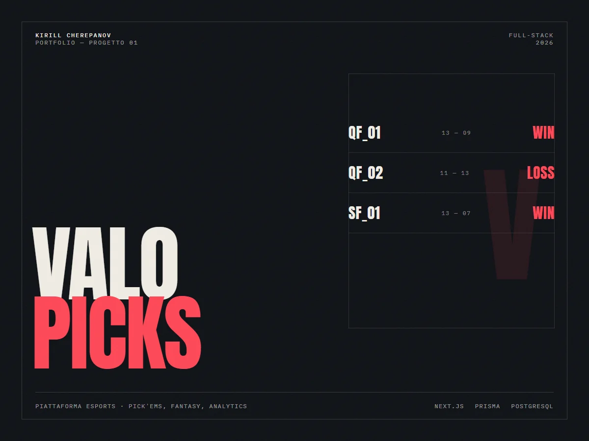

# ValoPicks

ValoPicks is a full-stack Valorant esports platform focused on:

- Tournament Pick'Ems predictions
- Fantasy league roster management
- Match and player analytics
- Leaderboards for Pick'Ems, Fantasy, and global ranking



## Stack

- Frontend: Next.js App Router + React + TypeScript
- Styling: TailwindCSS v4
- Backend: Next.js route handlers + server actions
- Database: PostgreSQL + Prisma ORM
- Auth: NextAuth with Google and Discord providers
- Realtime: Socket.IO heartbeat stream for live updates
- Deployment target: Vercel

## Theme

VLR-inspired esports data dashboard style with:

- Background: `#0f172a`
- Cards: `#111827`
- Accent: `#22c55e`
- Text: `#e5e7eb`

## Local Setup

1. Install dependencies:

```bash
npm install
```

2. Configure environment:

```bash
copy .env.example .env
```

3. Update `.env` values:

- `DATABASE_URL`
- `NEXTAUTH_SECRET`
- `NEXTAUTH_URL`
- `AUTH_USERNAME` / `AUTH_PASSWORD` (credential login)
- `CRON_SECRET` (protects the scheduled data refresh endpoint)
- `GOOGLE_CLIENT_ID` / `DISCORD_CLIENT_ID` and secrets if you enable those OAuth providers

4. Generate Prisma client and apply schema:

```bash
npm run db:generate
npx prisma db push
```

5. Seed mock data:

```bash
npm run db:seed
```

6. Start dev server:

```bash
npm run dev
```

## Key Routes

- `/` Home dashboard
- `/matches` Matches table
- `/matches/[id]` Match details
- `/pickems` Pick'Ems system
- `/fantasy` Fantasy league
- `/leaderboard` Rankings
- `/teams` Teams overview
- `/players` Players overview
- `/profile` User profile

## API Endpoints

- `GET /api/matches`
- `GET /api/matches/:id`
- `GET /api/teams`
- `GET /api/players`
- `GET /api/live-scores`
- `GET /api/mock`
- `GET /api/auth/*` (NextAuth)

## Realtime Notes

Socket.IO endpoint is wired at `src/pages/api/socket.ts` and consumed by `useLiveScores`.
For serverless production at scale, use managed pub/sub (for example Pusher or Ably) and replace the local socket server transport.

## Vercel Deployment

1. Import repository to Vercel.
2. Set all required environment variables.
3. Set build command to default `next build`.
4. Attach a PostgreSQL database and set `DATABASE_URL`.
5. Run `prisma db push` and `npm run db:seed` against the target DB.

## Status

The code is not deployed publicly. It needs a PostgreSQL instance, OAuth credentials and a data refresh job to be useful, so there is no live demo.

## Note

This project was built with AI assistance and tested by hand: the pages, API routes and auth flow were run locally against a real PostgreSQL database.

